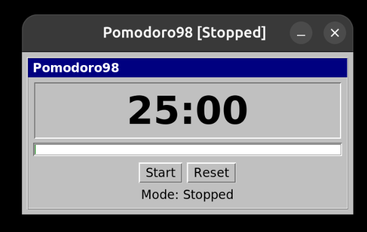

# Pomodoro98

A retro Windows 98–styled Pomodoro clock built with Python and Tkinter.

The code is a Python package in `src/pomodoro98/`; run it with `make run`,
`python3 -m pomodoro98`, or the installed `pomodoro98` command.

## Features

- **Focus timer** (default 25 minutes)
- **Rest timer** (default 5 minutes)
- **Pause and resume** without losing the remaining time
- **Reset** to a fresh focus session
- **Progress bar**: green during focus, red when focus ends and during rest
- **Always on top** window
- **Window title** shows the current mode, e.g. `Pomodoro98 [Focus]`
- **System tray icon** (optional via `pystray` + `Pillow`)
  - Green for focus
  - Red for rest
  - Tooltip shows time remaining

## First-time setup and prerequisites

Cloning or pulling this repository does not install system dependencies. Follow
these steps once on each new machine. Use the local setup to run the Python app;
follow the Flatpak setup below when you want to build and install a package.

Pomodoro98 is intended for Linux desktops with Python 3 and Tk installed. It is
developed on Wayland and should also work on X11. System-tray availability
depends on the desktop environment. Audio and tray integrations degrade
gracefully when their optional dependencies are unavailable.

### Run locally (Ubuntu/Debian)

Install Git, Make, Python, Tkinter, and virtual environment support:

```bash
sudo apt update
sudo apt install git make python3 python3-tk python3-venv
```

Clone the repository, or enter your existing checkout if you already have it:

```bash
git clone https://github.com/phni/pomodoro98.git
cd pomodoro98
```

Verify that Tkinter opens a test window, close it, then start the app:

```bash
python3 -m tkinter
make run
```

Run these commands in a graphical desktop session. No build step or pip packages
are needed for the core app. On other Linux distributions, install the equivalent
packages using your distribution's package manager.

### Optional tray and audio support

From the repository directory, create and activate a virtual environment:

```bash
python3 -m venv venv
source venv/bin/activate
```

The core application uses only Python and Tk, so it has no required pip
dependencies. Tkinter is supplied by your Python installation or operating
system, not pip. Install the app in editable mode with the optional system tray
and audio extras, then run the `pomodoro98` command:

```bash
python3 -m pip install -e '.[tray,audio,dev]'
pomodoro98
```

`requirements-optional.txt` lists the same optional packages for setups that
prefer a requirements file. Activate `venv` again in each new terminal when you
want these optional packages.

From the repository directory, you can also use `make run`. If it reports
`No module named tkinter`, install the OS Tkinter package above. Installing the
pip requirements does not install Tkinter.

Optional sound backends are attempted in this order: `simpleaudio`, `pygame`,
the Linux `aplay` command, and the Tk system bell.

## Flatpak development

### First-time Flatpak setup (Ubuntu/Debian)

Install the host tools and configure the Flathub remote:

```bash
sudo apt update
sudo apt install git make python3 flatpak appstream desktop-file-utils
flatpak remote-add --if-not-exists flathub https://dl.flathub.org/repo/flathub.flatpakrepo
```

For other distributions, follow the [Flathub setup instructions](https://flathub.org/en/setup).
Restart your desktop session after first installing Flatpak if needed for desktop
menu integration. System-wide setup may ask for administrator authentication.

From the repository directory, install Builder and the Freedesktop 25.08 runtime
and SDK, then build and run:

```bash
make setup-flatpak
make build
make install
make run-flatpak
```

The first setup/build needs internet access and downloads the runtime, SDK, and
source dependencies. The package bundles its own Tcl/Tk and Tkinter; host
`python3-tk` is needed for `make run`, not for the Flatpak application.

### Everyday Flatpak commands

After setup, run these commands from the repository directory:

```bash
make build         # build using cached dependency modules
make rebuild       # rebuild every module without the cache
make lint          # Python, metadata, and manifest validation
make lint-py       # Python checks only (no Flatpak needed)
make lint-repo     # build like Flathub and run the Flathub repo linter
make test          # non-interactive sandbox checks
make install       # install for the current user
make run-flatpak   # run the installed package
make uninstall     # remove the user-local package
```

Run `make help` for the complete command list. Build output and Builder caches
are local to the repository and ignored by Git.

The Makefile disables Flatpak Builder's `rofiles-fuse` cache mounts so builds
also work on hosts where those mounts fail. Build caching remains enabled for
`make build`; `make rebuild` disables cache lookups.

### Troubleshooting a fresh machine

| Error | Action |
| --- | --- |
| `No module named tkinter` with `make run` | Install `python3-tk`, then check `python3 -m tkinter` with the same Python environment. |
| `make: command not found` | Install the `make` OS package. |
| Flatpak is missing or the Flathub remote is missing | Complete the first-time Flatpak setup above. |
| Builder, runtime, or SDK is not installed | Run `make setup-flatpak` before `make build`. |
| `Failure spawning rofiles-fuse` | Use the updated Makefile, which passes `--disable-rofiles-fuse` for builds and installs. |
| App missing from the desktop launcher after `make install` | Run `make install` again with the current Makefile; older versions installed from inside the Builder sandbox and exported a broken launcher. |
| `no display name` or cannot connect to the display | Run the app from a graphical desktop session. |

## Screenshot



Pomodoro98 running a focus session on Linux.

## Contributing

See [CONTRIBUTING.md](CONTRIBUTING.md) for setup, coding conventions, and the
pull request process, and [CHANGELOG.md](CHANGELOG.md) for release notes.
Security issues: see [SECURITY.md](SECURITY.md).

## Maintainer

Maintained by [phni](https://github.com/phni).

Report bugs and request features through the
[GitHub issue tracker](https://github.com/phni/pomodoro98/issues).

## Version

The version is defined once, as `__version__` in `src/pomodoro98/__init__.py`.
`make lint` checks that the newest MetaInfo `<release>` matches it.

## License

Pomodoro98 is available under the [MIT License](LICENSE). Its SPDX identifier
is `MIT`.
